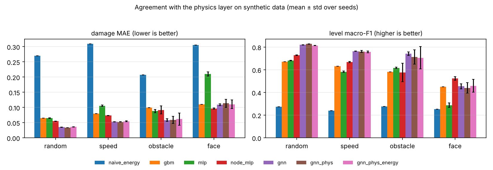

# CrashSense AI: damage prediction for vehicle–obstacle collisions

Predicts how a car **and the object it hits** look after a crash, part by part, so that a game engine can show it.

**Live demo: <https://vicky123411.github.io/crashsense-ai-damage-prediction/>**. Set up a crash in your browser and see
the damage; nothing to install (more under [Website](#website)).

You give it a speed, where the car is hit (side, position along that side, angle), what the car is made of
(steel grade and sheet thickness per part, total mass) and what it hits (concrete, steel, wood or foam; flat, round
or sharp; fixed or free to move). You get back:

* a damage value and a level (intact, scratched, dented, crushed, destroyed) for each of 28 car parts,
* which parts tear off,
* the damage of the obstacle, and whether it broke or was pushed away,
* crush depth, cabin intrusion, peak force and speed change,
* effect flags for the game: sparks, glass shards, smoke, fluid leak, debris, dust, front and side airbag.

The Unity scripts in `unity/` turn that report into dents, cracked glass, loose parts and particles.

The project grew out of a Unity car-crash simulation (Ramp Run) and a simple question: can the look of a crash be
predicted from speed, materials and hit position, so that artists and tools can set up post-crash effects faster?

> **Please read first.** The labels used here do not come from crash tests or finite-element simulations. They come
> from a small physics layer in this repository (an energy model of 28 boxes). The neural networks are trained to
> reproduce that layer, so the scores below measure *agreement with the physics layer on synthetic data*, not accuracy
> against real crashes. The physics layer is a plausibility model for visuals: its constants were chosen to give
> believable magnitudes and were not fitted to measurements. Unity's physics engine (PhysX) is not a structural
> solver either, so the Unity side only displays a predicted result. What the repository offers is a working pipeline
> that can later be trained on real solver output (there is an importer for that), not engineering accuracy, and it
> must not be used to judge vehicle safety. All assumptions and constants are in [`docs/method.md`](docs/method.md).

## How it fits together

```
 scenario (JSON) ──► physics layer ──► labelled data (damage per part, obstacle damage, flags)
                          │                      │
                          │                      ▼
                          │              graph neural network  (also MLP and boosting baselines)
                          ▼                      │
                    damage report  ◄─────────────┘            (same JSON from either engine)
                          │
                    HTTP server on localhost ──► Unity: dents, glass, loose parts, particles
```

* **Physics layer** (`crashdamage/physics.py`): impact energy from speed and masses; a contact patch from the size
  and position of the obstacle; crush forces from material, thickness and cross-section; a solver in which the weaker
  body (car or obstacle) gives way first; and damage that spreads along the load paths of the car
  (door → pillar → windscreen, ...). Damage is the share of a part's crush capacity that was used.
* **Learned models** (`crashdamage/models.py`): a graph neural network on the part graph, compared with a flat MLP,
  a per-part MLP, gradient boosting and a no-learning energy baseline.
* **Unity bridge** (`unity/`, `crashdamage/serve.py`): a small HTTP server and C# scripts.
* **Website** (`docs/`): the physics layer and the demo model written again in JavaScript, in one static page that
  runs in the browser without a server.

## Quick start

```bash
pip install -r requirements.txt          # numpy, scikit-learn, torch (CPU is enough), pytest, matplotlib

python -m crashdamage simulate examples/side_pole_29kmh.json    # physics layer: prints the damage report
python -m crashdamage generate --n 8000                         # labelled dataset -> data/synthetic.npz
python -m crashdamage train --model gnn --physics-features      # trains, prints test scores, saves models/gnn.pt
python -m crashdamage benchmark                                 # every model on every split (about an hour on 2 CPU cores)
python -m crashdamage serve --model models/gnn_demo.pt          # server for Unity on 127.0.0.1:8765
python -m http.server -d docs 8000                              # the website, at http://localhost:8000
pytest                                                          # 68 tests
```

`pip install -e .` also gives you a `crashdamage` command. Tested with Python 3.13 (numpy 2.5, scikit-learn 1.9,
PyTorch 2.15, CPU only). A small demo model, `models/gnn_demo.pt`, is included.
It was trained with `python -m crashdamage train --model gnn --physics-features --epochs 60 --out models/gnn_demo.pt`
on the random split of the 8000 synthetic scenarios (5600 for training, 1200 for validation; it stopped early at
epoch 48). On the 1200 held-out test scenarios its damage error is 0.0325 on average, the damage level is right in
86% of the cases (99% within one level), detaching parts is predicted with F1 0.95, and the average errors are
0.065 m for crush depth and 0.047 m for cabin intrusion.

## Website

[`docs/`](docs) holds a static page that does what `python -m crashdamage simulate` does, in the browser. It is
published with GitHub Pages (branch `main`, folder `/docs`) at
<https://vicky123411.github.io/crashsense-ai-damage-prediction/>.

You choose the car (mass, steel grades), the obstacle, the speed and where the car is hit. The page draws the car
from above and from the side with every part coloured by its damage, lists the effects a game should show, and gives
crush depth, cabin intrusion, peak force, speed change and where the energy goes. A switch picks the demo model, the
physics layer, or both side by side, and the page warns when an input is outside the range the model was trained on.
"Copy link to this crash" makes a link that opens the same crash; the request and report buttons copy the same JSON
as the Unity bridge.

There is no server and no build step. The physics layer and the demo network are written again in JavaScript
(`docs/js/`); the weights and tables are in `docs/data/`.

```bash
python -m http.server -d docs 8000        # then open http://localhost:8000
python scripts/export_web_data.py --model models/gnn_demo.pt --metrics results/demo_model_metrics.txt   # after retraining
node tests/web/check_parity.mjs           # JavaScript against Python on 55 cases
```

The parity check compares the physics layer to 1e-9 and the network to 2e-4. A run on 1,515 cases (made with
`scripts/make_web_parity.py --n 1500`) had no failures. The browser tests in `tests/test_web_site.py` open the page
with Playwright (`pip install playwright && playwright install chromium`) and compare what it shows with the Python
code; they are skipped when Playwright is not installed.

## Example

`examples/side_pole_29kmh.json`: the left side of a 1300 kg car meets a 25 cm steel pole at 29 km/h, in the middle
of the door.

```json
{"speed_kmh": 29, "face": "left", "offset": 0.0, "angle_deg": 0,
 "vehicle": {"mass_kg": 1300}, "obstacle": {"name": "steel_pole", "width": 0.25}}
```

Physics layer: crush depth 0.64 m, cabin intrusion 0.28 m, peak force 115 kN, 42 kJ absorbed by the car and none by
the pole (it stays intact), speed change 8.5 m/s. Effects: sparks, debris, side airbag. The most damaged parts:

| part | damage | level | torn off |
|---|---:|---|---|
| door_l | 1.00 | destroyed | yes |
| sill_l | 1.00 | destroyed | no |
| floor_cabin | 1.00 | destroyed | no |
| sill_r | 0.70 | crushed | no |
| roof | 0.67 | crushed | no |
| rear_structure | 0.60 | crushed | no |
| pillar_b_l | 0.51 | crushed | no |
| pillar_b_r | 0.50 | crushed | no |

The demo model answers the same scenario in the same range
(`python -m crashdamage simulate examples/side_pole_29kmh.json --model models/gnn_demo.pt --engine model`):

| | physics layer | demo model |
|---|---:|---:|
| crush depth (m) | 0.64 | 0.70 |
| cabin intrusion (m) | 0.28 | 0.29 |
| peak force (kN) | 115 | 125 |
| door_l damage | 1.00, torn off | 1.00, torn off |
| sill_r damage | 0.70 | 0.73 |
| roof damage | 0.67 | 0.55 |
| firewall damage | 0.30 | 0.42 |

The effect flags (sparks, debris, side airbag) and the intact pole agree. Over all 28 parts the damage values differ
by 0.024 on average for this scenario. Damage levels are cut from the damage value at fixed thresholds, so a model
value just below a threshold gets the lower level, as with the right B-pillar (0.50 "crushed" against just under 0.50
"dented").

The right sill and right B-pillar are on the far side of the hit. They come out "crushed" because damage spreads
over hand-set connection weights, which is probably more than a real pole test would show; see the limitations
below.

All scenarios in `examples/` through the physics layer (`python scripts/examples_table.py`):

| example | speed (km/h) | crush depth (m) | cabin intrusion (m) | peak force (kN) | parts crushed or destroyed | torn off | obstacle | effects |
|---|---:|---:|---:|---:|---:|---|---|---|
| foam_barrier_56kmh | 56 | 0.46 | 0.00 | 236 | 7 | bumper_front, radiator | crushed | smoke, fluid leak, debris, airbag front |
| free_concrete_block_40kmh | 40 | 0.64 | 0.00 | 1015 | 5 | bumper_front, radiator, engine | intact | sparks, smoke, fluid leak, debris, airbag front |
| front_wall_56kmh | 56 | 0.63 | 0.00 | 1575 | 10 | bumper_front, radiator, bonnet | intact | sparks, smoke, fluid leak, debris, airbag front |
| mild_vs_ultra_high_strength_front | 56 | 0.48 | 0.00 | 572 | 7 | bumper_front, radiator, bonnet, fender_l, fender_r | intact | sparks, smoke, fluid leak, debris, airbag front |
| offset_front_pole_50kmh | 50 | 0.76 | 0.00 | 328 | 9 | bumper_front, radiator, engine, bonnet | destroyed | sparks, smoke, fluid leak, debris, airbag front |
| side_pole_29kmh | 29 | 0.64 | 0.28 | 115 | 8 | door_l | intact | sparks, debris, airbag side |
| wood_fence_50kmh | 50 | 0.07 | 0.00 | 49 | 1 | bumper_front | destroyed (broke) | debris, dust, airbag front |

A request may also change materials and thicknesses of single parts and the obstacle (every field is optional; 0 or
an empty string keeps the preset):

```json
"vehicle": {"mass_kg": 1100, "materials": [{"part": "beam_front", "material": "ultra_high_strength_steel"}]}
```

## Results on synthetic data

8000 random crashes labelled by the physics layer: random cars (mass, steel grades, thickness), eight obstacle
presets, all four sides, random offset, angle and speed (4 to 36 m/s). Neural models were trained with 3 seeds, at
most 40 epochs, early stopping on a validation set; the table shows mean ± standard deviation on the test rows.
Four ways of splitting the data:

* **random**: ordinary 70/15/15 split (1,200 test crashes)
* **speed**: trained below 24 m/s (86 km/h), tested above it (2,967 test crashes)
* **obstacle**: the `steel_crate` obstacle never appears in training (1,034 test crashes)
* **face**: the rear of the car is never hit in training (820 test crashes)

The first row of the first table is the error of answering "no damage" for every part, which gives the other
numbers a scale.

**Damage MAE (mean absolute error of the 0-1 damage value, lower is better)**

| model | random | speed | obstacle | face |
|---|---:|---:|---:|---:|
| *no damage anywhere (reference)* | 0.2775 | 0.3339 | 0.2592 | 0.2448 |
| naive_energy | 0.2699 | 0.3091 | 0.2070 | 0.3053 |
| gbm | 0.0646 | 0.0796 | 0.0991 | 0.1102 |
| mlp | 0.0649 ± 0.0007 | 0.1052 ± 0.0024 | 0.0881 ± 0.0052 | 0.2100 ± 0.0072 |
| node_mlp | 0.0548 ± 0.0006 | 0.0735 ± 0.0005 | 0.0916 ± 0.0135 | 0.0964 ± 0.0018 |
| gnn | 0.0353 ± 0.0004 | 0.0529 ± 0.0006 | 0.0583 ± 0.0044 | 0.1090 ± 0.0032 |
| gnn_phys | 0.0337 ± 0.0001 | 0.0524 ± 0.0004 | 0.0586 ± 0.0119 | 0.1135 ± 0.0128 |
| gnn_phys_energy | 0.0360 ± 0.0004 | 0.0542 ± 0.0015 | 0.0619 ± 0.0202 | 0.1105 ± 0.0141 |

**Damage level macro-F1 (five levels, higher is better)**

| model | random | speed | obstacle | face |
|---|---:|---:|---:|---:|
| naive_energy | 0.275 | 0.239 | 0.275 | 0.252 |
| gbm | 0.672 | 0.631 | 0.581 | 0.449 |
| mlp | 0.682 ± 0.002 | 0.583 ± 0.006 | 0.616 ± 0.007 | 0.287 ± 0.020 |
| node_mlp | 0.729 ± 0.003 | 0.668 ± 0.006 | 0.576 ± 0.082 | 0.523 ± 0.016 |
| gnn | 0.820 ± 0.001 | 0.764 ± 0.003 | 0.741 ± 0.016 | 0.454 ± 0.022 |
| gnn_phys | 0.827 ± 0.001 | 0.761 ± 0.010 | 0.712 ± 0.063 | 0.440 ± 0.047 |
| gnn_phys_energy | 0.813 ± 0.001 | 0.757 ± 0.008 | 0.706 ± 0.099 | 0.458 ± 0.056 |



More scores (R², detaching parts, crush depth, damage of the obstacle, through-car flag) are in
[`results/benchmark.md`](results/benchmark.md); the numbers of every seed are in
[`results/benchmark_raw.json`](results/benchmark_raw.json).

The variants: `naive_energy` shares the impact energy over the loaded parts by capacity and learns nothing; `gbm`
is gradient boosting; `mlp` sees the whole scenario as one flat vector; `node_mlp` is a per-part network without
message passing; `gnn` passes messages along the part graph; `gnn_phys` also gets the energy and capacity numbers
of the physics layer as inputs, and `gnn_phys_energy` adds a loss term that penalises damage totals the energy
cannot pay for. `naive_energy` and `gbm` were run once, the neural models three times.

What the four splits show:

* **Random split.** The graph network nearly halves the damage error of the flat MLP and of gradient boosting
  (0.035 against 0.065), and its macro-F1 over the five damage levels is 0.82 against 0.67 to 0.68.
* **Speed split** (tested on crashes faster than anything in training). Every learned model gets worse, the flat MLP
  most (0.065 to 0.105). The graph networks are still the best (0.052 to 0.054), so the part graph also helps a
  little beyond the training range.
* **Obstacle split** (the steel crate is never seen). The graph networks are again ahead on damage (0.058 to 0.062
  against 0.088 to 0.099), but their results differ a lot between seeds (± 0.004 to ± 0.020), so the order among the
  three graph variants means nothing. Every learned model predicts the damage of the unseen obstacle itself badly
  (error 0.29 to 0.38, against 0.06 to 0.11 on the random split): a new kind of obstacle needs examples in the
  training data.
* **Face split** (the rear is never hit in training). This is the hardest test, and the only one where the graph
  networks do not win. The per-part network is best (0.096), the graph networks and gradient boosting are close
  behind (about 0.11), and the flat MLP is hardly better than saying "no damage" (0.210 against 0.245). Hits from a
  side that was never in the training data are not handled well by any model. The demo model was trained on all four
  sides.
* **Inputs from the physics layer.** Giving the graph network the energy and capacity numbers of the physics layer
  (`gnn_phys`) helps a little on the random split (0.034 against 0.035) and makes no visible difference on the other
  three, where the gaps are inside the spread between seeds. These numbers are computed by the physics layer
  itself, so this variant is the least independent of the labels. The demo model and the website use it. The
  energy-consistency loss (`gnn_phys_energy`) gave no consistent gain.
* **No-learning baseline.** `naive_energy` beats "no damage" by 3% to 20% on three splits (0.270 against 0.278 on
  the random split, 0.207 against 0.259 on the obstacle split) and loses to it on the face split (0.305 against
  0.245). Its R² is below zero on three of the four splits.
* **Spread.** Three seeds are few. Treat differences inside the ± range as ties.
* **A fixed bug.** The first run of the face split gave nonsense for the neural models (mostly all 0 or all 1),
  because the input scaling divided a column that never changes in training, the one-hot of the rear face, by about
  1e-6. That is fixed (commit "Leave constant columns unscaled in the input normaliser") and the face split was run
  again. The other three splits have no such column, so their numbers did not change.

### Speed

`python scripts/time_inference.py` times both engines on 1000 random scenarios (CPU only, 2 cores; the output is in
[`results/speed.txt`](results/speed.txt)):

| | per scenario |
|---|---:|
| physics layer, one request at a time | 0.44 ms |
| demo model, one request at a time | 1.27 ms |
| demo model, a whole batch at once | 0.18 ms for the inputs + 0.11 ms for the network |

For a single request the model is slower than the physics layer, not faster: one request includes building the
inputs, one PyTorch call and writing the report, and even in a batch the inputs cost more than the network. With one
PyTorch thread the network step takes 0.18 ms instead of 0.11 ms. A learned model only pays off when its labels come
from a solver that is much slower than the physics layer, which this repository has not done (see `external.py`).

## Repository layout

```
crashdamage/
  materials.py   material table (rough textbook values)
  vehicle.py     the 28-part car, its part graph, random car variants
  obstacles.py   obstacle presets, forms, shapes
  physics.py     energy model: contact patch, crush forces, solver, damage spreading
  features.py    the numbers that go into the models
  dataset.py     random scenarios, labelling, splits
  models.py      graph network and MLPs
  baselines.py   energy baseline and gradient boosting
  train.py       training loop, saving and loading
  metrics.py     scores
  evaluate.py    benchmark over models and splits
  export.py      damage report JSON (physics layer or model)
  serve.py       HTTP server for the game engine
  external.py    CSV import for labels from OpenRadioss / LS-DYNA runs
  cli.py         python -m crashdamage ...
unity/           C# scripts and set-up notes
examples/        scenario files
docs/            the website (index.html, css/, js/, data/) and method.md, which lists everything the code assumes
scripts/         example table, result table and plot, timing, export of the website data, parity cases
results/         benchmark tables, chart and raw numbers, timing, scores of the demo model
tests/           pytest; tests/web/ has the JavaScript parity check
```

## Limitations

* **No real data.** There is no comparison with crash tests or solver runs. The constants were chosen for plausible
  magnitudes (a 1.1 t car into a rigid wall at 56 km/h crushes about 0.6 m), not fitted.
* **One car layout**: a compact car made of 28 boxes. Variants differ in mass, materials and thickness only.
* **Quasi-static energy model**: no time history, only a small restitution, no friction, no sliding off a glancing hit.
* **Damage spreading is a heuristic.** It follows hand-set connection weights, so far-side parts can look more damaged
  than in a real test (the right sill in the example above), and a stronger rail can pass more force to its
  neighbours and tear the fenders off even though the crush is shallower (`mild_vs_ultra_high_strength_front`).
* **Peak force is jumpy.** It is the largest value of a stepwise force curve, and it rises sharply when the car
  reaches a stiff block such as the engine. Treat it as a rough indicator.
* **Narrow hard objects go through the car.** In 11% of the generated scenarios the obstacle passes through
  the whole car in the model (the steel edge in 53% of its scenarios, the steel pole in 17%). The report then
  says `went_through_car` and gives the unabsorbed energy; read the damage as "destroyed along the line of the hit".
* **Narrow objects damage whole parts.** The damage of a part is the share of the crush capacity of the strip that is
  touched, so a narrow object that uses up its strip gives the whole part a damage of 1.0. A 21 cm wooden post hit
  head-on at 12 km/h destroys the bumper, the bumper beam and the radiator, crushes the bonnet and gives a crush depth
  of about 0.6 m, although only 1.7 kJ of the 7.2 kJ goes into the car. The demo model gives the same picture
  (0.54 m), and the website calls both "Heavy damage", which is probably more than a real 12 km/h hit would do.
* **Models inherit the physics layer's assumptions** and are only as good as that layer; the scores are agreement
  scores, not accuracy.
* **The Unity scripts were never run in Unity.** They compile (C# 9) against stand-in Unity types, which only catches
  typos and wrong names between the scripts, not problems with the real Unity API. Expect small fixes on first import.
* **The CSV importer for solver labels** was only tested on files this project writes itself.

## Ideas for next steps

* Train on real solver data (OpenRadioss or LS-DYNA runs, or a public crash dataset) through `external.py`, and
  calibrate the constants against it.
* More vehicle layouts, and car-to-car crashes where both bodies are deformable.
* Make damage depend on how much of a part's width is touched, so that narrow objects stop damaging whole parts.
* A mesh-level graph network for the shape of the dent, not only per-part damage.
* Try the Unity scripts in the Ramp Run scene and tune the dent and effect parameters with artists.

## License

MIT, see [`LICENSE`](LICENSE).
